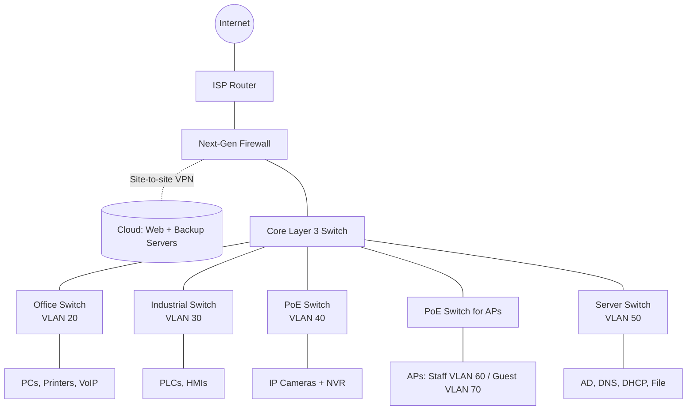
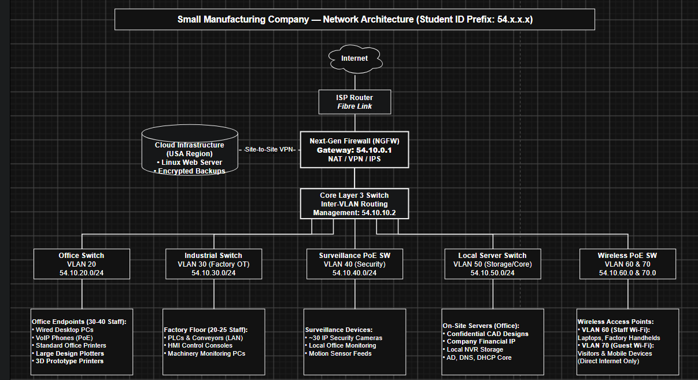

# Draft Network Design (v0.1)

**IS355 Networking and Cyber Security — Colin Muller, Collin Morris, Kairi Thomas, Mohammad Abukhdeir**

> Status: DRAFT. Assumptions below must be checked against the company scenario in the Project Specification before the final submission.

## 1. Assumptions

| # | Assumption | To confirm |
|---|------------|------------|
| A1 | The company operates from a single site containing both a factory floor and an office area. | Number of sites/buildings |
| A2 | Around 50 office users, each with a PC, plus shared printers and VoIP phones. | User and device counts |
| A3 | The factory floor has PLCs, HMIs and shop-floor PCs that need network access but should be isolated from office traffic. | Factory equipment list |
| A4 | Up to 30 IP security cameras record to an on-site Network Video Recorder (NVR). | Camera count |
| A5 | Staff need wireless access in the office and factory; visitors need internet-only guest Wi-Fi. | Wi-Fi coverage areas |
| A6 | The public web server and the backup server are hosted with a cloud provider (see Cloud Services section), not on-site. | Spec requirement |
| A7 | On-site servers provide directory services (AD), DNS, DHCP and file storage. | Required on-site services |
| A8 | A single business fibre internet connection is used; a backup connection is a possible future addition. | Budget and uptime needs |

## 2. Requirements

1. Separate the factory, office, security camera, server and wireless networks so a problem in one area cannot easily spread to another.
2. Provide reliable wired connectivity for office and factory devices.
3. Power cameras and wireless access points over Ethernet (PoE) to reduce cabling.
4. Give staff secure wireless access and keep guest wireless separate from internal systems.
5. Provide secure connectivity between the site and the cloud-hosted web and backup servers.
6. Allow the network to grow without redesigning the addressing scheme.
7. Restrict management access to network devices to a dedicated management network.

## 3. Network Structure

The design uses a **collapsed-core** model, which suits a single-site company of this size:

- **Edge:** The ISP connection terminates on a next-generation firewall that performs NAT, hosts the site-to-site VPN to the cloud provider, and runs intrusion prevention.
- **Core:** A Layer 3 core switch routes between VLANs. The firewall enforces which VLANs may talk to each other.
- **Access:** Separate access switches serve the office, factory, cameras, wireless access points and servers. Each connects to the core over a trunk link.

Segmentation is done with **VLANs**, one per functional area.

## 4. IP Addressing and VLANs

The private range `10.10.0.0/16` is used, giving room for future VLANs. The third octet matches the VLAN ID so addresses are easy to recognise.

| VLAN | Name | Subnet | Gateway | Usable hosts | Purpose |
|------|------|--------|---------|--------------|---------|
| 10 | Management | 10.10.10.0/24 | 10.10.10.1 | 254 | Switch, firewall and AP management interfaces |
| 20 | Office | 10.10.20.0/24 | 10.10.20.1 | 254 | Office PCs, printers, VoIP phones |
| 30 | Factory | 10.10.30.0/24 | 10.10.30.1 | 254 | PLCs, HMIs, factory PCs |
| 40 | Cameras | 10.10.40.0/24 | 10.10.40.1 | 254 | IP cameras and NVR |
| 50 | Servers | 10.10.50.0/24 | 10.10.50.1 | 254 | AD/DNS/DHCP, file server |
| 60 | Staff Wi-Fi | 10.10.60.0/24 | 10.10.60.1 | 254 | Staff laptops and mobile devices |
| 70 | Guest Wi-Fi | 10.10.70.0/24 | 10.10.70.1 | 254 | Visitors, internet only |

`/24` subnets are deliberately larger than current needs so each area can grow. Servers, printers, network devices and the NVR use static addresses at the bottom of each range; client devices receive addresses from DHCP.

---

### Appended Note: Potential Addressing Model (v2 Proposal)

> **Note:** Updated to use student ID prefix `54.x.x.x` with `/24` subnets, matching the network architecture diagram in Section 7.

| VLAN | Name | Subnet | Gateway | Usable Hosts | Purpose & Key Hardware |
|:---|:---|:---|:---|:---|:---|
| **10** | Management | `54.10.10.0/24` | `54.10.10.1` | 254 | Switch, firewall, and AP admin interfaces |
| **20** | Office Wired | `54.10.20.0/24` | `54.10.20.1` | 254 | 30–40 Office PCs, VoIP, 3D Prototype Printers, Plotters |
| **30** | Factory OT | `54.10.30.0/24` | `54.10.30.1` | 254 | 20–25 Workers' machinery, PLCs, HMIs, assembly lines |
| **40** | Cameras | `54.10.40.0/24` | `54.10.40.1` | 254 | ~30 IP surveillance cameras streaming locally |
| **50** | Local Servers | `54.10.50.0/24` | `54.10.50.1` | 254 | On-site CAD designs, financial IP storage, local NVR, AD/DNS |
| **60** | Staff Wi-Fi | `54.10.60.0/24` | `54.10.60.1` | 254 | Office laptops and factory floor mobile monitoring devices |
| **70** | Guest Wi-Fi | `54.10.70.0/24` | `54.10.70.1` | 254 | Visitors and personal phones (isolated to internet) |

## 5. Traffic Rules Between VLANs (draft)

| From → To | Allowed? | Reason |
|-----------|----------|--------|
| Office → Servers | Yes | File shares, authentication |
| Factory → Servers | Limited | Only the specific services factory systems need |
| Office ↔ Factory | No (except named exceptions) | Protects production systems from office threats |
| Cameras → anything except NVR | No | Cameras are a common attack target |
| Guest Wi-Fi → internal VLANs | No | Internet access only |
| Management VLAN | IT admin devices only | Protects device configuration |

## 6. Recommended Equipment (draft)

| Device | Example | Justification |
|--------|---------|---------------|
| Firewall | Fortinet FortiGate 100F (or similar NGFW) | Combines firewall, VPN and IPS in one device; suitable throughput for a mid-sized site |
| Core switch | Cisco Catalyst 9300 (Layer 3) | Inter-VLAN routing and high-speed uplinks to access switches |
| Office access switch | Cisco Catalyst 9200 48-port PoE | Enough ports for office users; PoE for VoIP phones |
| Factory switch | Cisco IE3300 industrial switch | Tolerates dust, heat and vibration on the factory floor |
| Camera / AP switches | 24-port PoE+ switches | PoE+ powers cameras and Wi-Fi 6 access points |
| Wireless | Wi-Fi 6 access points with central management | Supports multiple SSIDs mapped to VLANs 60 and 70 |
| NVR | Enterprise NVR sized for camera count and retention period | Local recording keeps camera traffic off the internet link |

Final model choices will be confirmed once device counts in the scenario are checked.

## 7. Network Diagram

The editable diagram is in [`network-diagram.drawio`](../diagrams/network-diagram.drawio) (open it at [app.diagrams.net](https://app.diagrams.net)). An exported image is below.

A simplified version that renders directly on GitHub:

---

### Detailed Network Topology & Addressing (Student ID Prefix: 54)

The editable diagrams.net source file is available at [`network-architecture.drawio`](diagrams/network-architecture.drawio).

## 8. Open Questions for the Group

- Do the device counts in the scenario fit the assumptions above?
- Does the company need a second internet connection for redundancy?
- Should the NVR sit in the camera VLAN (current design) or the server VLAN?
- Which security controls from the risk assessment (Week 11–12) will change this design?

