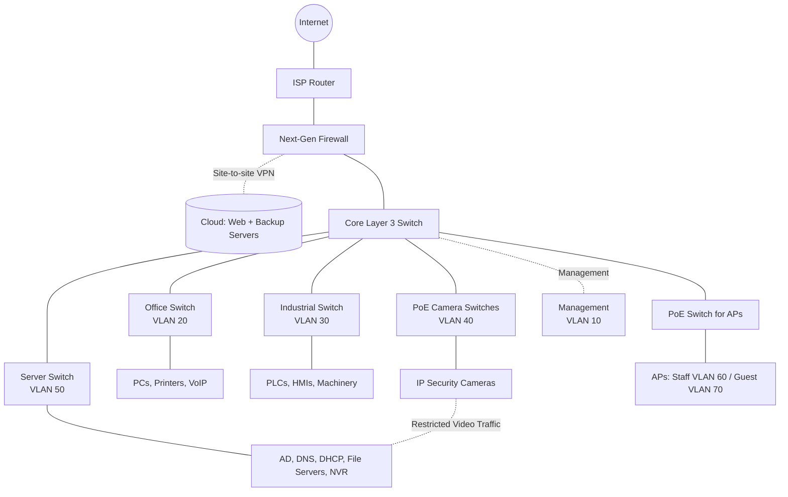

# Draft Network Design (v0.2)

**IS355 Networking and Cyber Security — Colin Muller, Collin Morris, Kairi Thomas, Mohammad Abukhdeir**

> **Status: DRAFT.** This document presents the proposed network design for the manufacturing company described in the Project Specification. Device counts, equipment models, and certain technical configurations are preliminary and will be confirmed before final submission.

## 1. Assumptions

The following assumptions were made where the Project Specification does not provide exact technical requirements.

| # | Assumption | Status / To Confirm |
|---|------------|---------------------|
| A1 | The company operates from one location with two attached buildings: a factory and an office building. | Confirmed in Project Specification |
| A2 | The office building has approximately 30–40 staff members using a combination of desktop computers, laptops, VoIP phones, and shared printers. | Staff count confirmed; exact device quantities to be determined |
| A3 | The factory has approximately 20–25 workers and network-connected machinery, including PLCs, HMIs, and monitoring computers. | Worker count confirmed; equipment types and quantities to be determined |
| A4 | Approximately 30 IP security cameras will be installed throughout the factory and office buildings, recording to a local Network Video Recorder (NVR). | Camera quantity and storage requirements to be confirmed |
| A5 | Employees require wireless connectivity in both buildings. A separate guest wireless network will provide visitors and personal devices with internet-only access. | Wireless coverage and access point quantities to be confirmed |
| A6 | The public website and encrypted backup server will be hosted with a cloud provider, while confidential company files remain primarily on local servers. | Cloud provider and server specifications to be determined |
| A7 | Local servers will provide file storage, directory services, DNS, and DHCP. | Specific server configurations and operating systems to be determined |
| A8 | The company will initially use one business-grade fiber internet connection, with the option to add a secondary connection for redundancy. | Internet bandwidth, provider, and budget to be confirmed |
| A9 | The network will use managed switches that support VLANs, access control lists, and high-speed uplinks. | Final switch specifications to be determined |
| A10 | The IP addressing scheme will use the student ID prefix `54` and `/24` subnet masks to satisfy the Project Specification. | Confirm that 54 is the last two digits of a group member's student ID |

## 2. Requirements

The network design must meet the company's operational requirements while providing adequate security, reliability, and scalability.

### 2.1 Functional Requirements

1. Provide reliable network connectivity throughout the factory and attached office building.
2. Support approximately 30–40 office employees and 20–25 factory workers.
3. Connect office computers, laptops, VoIP phones, standard printers, engineering plotters, and 3D prototype printers.
4. Support factory equipment that communicates using wired Ethernet or wireless connections.
5. Provide connectivity between production machinery, monitoring computers, and other authorized industrial systems.
6. Support approximately 30 IP-based security cameras that transmit video to a local recording server.
7. Provide secure wireless access for employees in both buildings.
8. Provide a separate guest wireless network with internet-only access.
9. Maintain local servers for confidential engineering designs, financial records, and other important intellectual property.
10. Support cloud-hosted services, including the public website and encrypted off-site backups.

### 2.2 Security Requirements

1. Separate factory, office, security camera, server, staff wireless, guest wireless, and management traffic using VLANs.
2. Prevent unauthorized communication between the office network and factory equipment.
3. Restrict guest wireless users from accessing internal company resources.
4. Limit security camera communications to the local NVR and approved management services.
5. Restrict administrative access to network equipment to authorized IT personnel.
6. Use a next-generation firewall to protect the company's internet connection.
7. Provide secure connectivity to cloud services using encrypted connections and, where appropriate, a site-to-site VPN.
8. Apply access control lists (ACLs) and firewall policies to restrict unnecessary network traffic.

### 2.3 Performance and Scalability Requirements

1. Provide sufficient network capacity for existing devices and future expansion.
2. Use high-speed connections between the core and access switches to reduce congestion.
3. Support Power over Ethernet (PoE) for compatible security cameras, wireless access points, and VoIP phones.
4. Use `/24` subnets to allow additional devices to be connected without redesigning the addressing scheme.
5. Maintain reliable local communication between factory controllers and monitoring equipment.
6. Minimize the impact of camera video traffic on ordinary office and factory network operations.

## 3. Network Structure

The proposed network uses a **collapsed-core architecture**, which combines the core and distribution functions into a single logical network layer.

This design is appropriate because the company operates from one location consisting of two attached buildings. A collapsed-core design offers reliable performance and centralized management without the additional cost and complexity of a traditional three-tier enterprise network.

### 3.1 Edge Layer

The edge layer connects the company's internal network to its internet service provider.

A next-generation firewall will be installed between the ISP equipment and the core switch.

The firewall will provide:

- Network Address Translation (NAT).
- Stateful traffic inspection.
- Intrusion Prevention System (IPS) capabilities.
- Internet access filtering.
- VPN connectivity to cloud resources.
- Protection against unauthorized inbound connections.
- Logging and monitoring of network security events.

A site-to-site VPN may be established between the firewall and the selected cloud provider for private communication with cloud-hosted resources.

The public website will remain accessible through the cloud provider's internet-facing infrastructure without requiring external users to connect directly to the company's internal network.

### 3.2 Core Layer

A Cisco Catalyst 9300 Layer 3 switch, or equivalent, will serve as the network's collapsed core.

The core switch will:

- Connect the access switches throughout both buildings.
- Provide routing between internal VLANs.
- Use Access Control Lists (ACLs) to restrict unauthorized inter-VLAN communication.
- Provide high-speed connections to the access switches.
- Support additional VLANs and devices as the company expands.

The default gateway for each internal VLAN will be configured on the Layer 3 core switch.

The core switch will use a default route toward the next-generation firewall for traffic destined for external networks.

**Security consideration:** Because the core switch performs inter-VLAN routing, ACLs on the core switch will enforce internal network segmentation. The firewall will primarily enforce internet and cloud connectivity security policies. Sensitive inter-VLAN traffic may be routed through a firewall in a future design if deeper inspection is required.

### 3.3 Access Layer

The access layer provides direct connectivity to individual network devices.

Separate access switches will serve the following areas:

- **Office:** Desktop computers, printers, engineering equipment, and VoIP phones.
- **Factory:** Industrial machinery, PLCs, HMIs, and production monitoring devices.
- **Security cameras:** IP surveillance cameras located throughout both buildings.
- **Wireless:** Access points providing employee and guest Wi-Fi.
- **Local servers:** File servers, authentication services, and security video storage.

Managed switches will connect to the core using high-speed uplinks.

Where required, VLAN trunk links will carry multiple tagged VLANs between network equipment. Ordinary end devices will connect using access ports assigned to their appropriate VLANs.

### 3.4 Wireless Network

Wireless access points will provide connectivity in both buildings.

Two primary wireless networks will be configured:

**Staff Wi-Fi — VLAN 60**

- Intended for authorized employees and approved wireless devices.
- Provides controlled access to necessary internal resources.
- Uses WPA3-Enterprise where supported, with centralized authentication.
- Allows authorized factory monitoring devices to access only required production services.

**Guest Wi-Fi — VLAN 70**

- Intended for visitors and personal devices that do not require internal access.
- Provides internet access only.
- Blocks access to internal VLANs.
- Uses client isolation where supported to prevent unnecessary device-to-device communication.

Wireless access point placement will be determined after evaluating building layouts, expected users, and potential interference from factory machinery.

## 4. IP Addressing and VLANs

The network will use the student ID addressing prefix `54` with `/24` subnet masks.

This approach follows the Project Specification requirement that the first octet of the network's IP addresses must match the final two digits of a group member's student ID.

> **Important:** The `54.x.x.x` addressing range is used to satisfy the academic project requirements. It is not an RFC 1918 private address range. In a real-world deployment, private addresses would normally be selected to avoid conflicts with publicly assigned IP addresses. This design must therefore be understood as an academic addressing model.

Each VLAN will use a separate `/24` subnet, providing 254 usable host addresses.

The third octet corresponds to the VLAN number to simplify network identification and administration.

| VLAN | Name | Subnet | Default Gateway | Usable Hosts | Purpose and Key Hardware |
|------|------|--------|-----------------|--------------|--------------------------|
| 10 | Management | `54.10.10.0/24` | `54.10.10.1` | 254 | Management interfaces for switches, firewall, and wireless access points |
| 20 | Office Wired | `54.10.20.0/24` | `54.10.20.1` | 254 | Office PCs, VoIP phones, general-purpose printers, plotters, and 3D prototype printers |
| 30 | Factory OT | `54.10.30.0/24` | `54.10.30.1` | 254 | Factory machinery, PLCs, HMIs, and production monitoring computers |
| 40 | Cameras | `54.10.40.0/24` | `54.10.40.1` | 254 | Approximately 30 IP surveillance cameras |
| 50 | Local Servers | `54.10.50.0/24` | `54.10.50.1` | 254 | Engineering design storage, financial records, NVR, AD, DNS, DHCP, and file servers |
| 60 | Staff Wi-Fi | `54.10.60.0/24` | `54.10.60.1` | 254 | Employee laptops, approved wireless devices, and factory monitoring devices |
| 70 | Guest Wi-Fi | `54.10.70.0/24` | `54.10.70.1` | 254 | Visitors and personal devices requiring internet-only access |

### 4.1 Address Allocation

The following addressing guidelines will be used throughout the network:

- `.1` will be reserved for the default gateway within each VLAN.
- `.2–.49` will generally be reserved for infrastructure and other devices requiring fixed addresses.
- `.50–.199` will generally be available for DHCP-assigned client devices.
- `.200–.254` will be reserved for future expansion or additional static allocations.

Actual reservations and DHCP scopes will be configured according to the needs of each VLAN.

Servers, switches, PLCs, cameras, printers, and other infrastructure equipment will generally use static IP addresses or DHCP reservations.

Employee computers, laptops, and guest devices will generally receive their addresses through DHCP.

### 4.2 Addressing Justification

Using separate `/24` networks provides several advantages:

1. Meets the Project Specification's subnet mask requirements.
2. Provides sufficient addresses for the company's current device population.
3. Simplifies troubleshooting by grouping devices according to their functions.
4. Supports network isolation through VLANs and ACLs.
5. Allows additional devices to be added without immediately requiring new subnets.
6. Makes it easier for administrators to identify a device's network based on its IP address.

Although each subnet supports up to 254 usable host addresses, the company is not expected to require that many devices in every VLAN initially.

### 4.3 Factory Wireless Considerations

Some manufacturing devices may require wireless connectivity.

Approved wireless monitoring devices will connect through the staff wireless infrastructure, with ACLs allowing access only to necessary factory systems.

Network-connected machinery that requires direct participation in the factory control network may instead be assigned to VLAN 30 through appropriately configured industrial wireless infrastructure.

This arrangement limits unnecessary communication between ordinary employee devices and production equipment.

## 5. Traffic Rules Between VLANs

Network traffic will be restricted using ACLs on the Layer 3 core switch and security policies on the next-generation firewall.

The network will follow a **default-deny approach for inter-VLAN traffic**, allowing communication only when required for business operations.

| Source | Destination | Access | Justification |
|--------|-------------|--------|---------------|
| Office VLAN 20 | Server VLAN 50 | Limited / Allowed | Access to approved file shares, authentication, DNS, and business applications |
| Factory VLAN 30 | Server VLAN 50 | Limited | Access to required production data, authentication, and monitoring services |
| Office VLAN 20 | Factory VLAN 30 | Denied by default | Prevents ordinary office devices from accessing production equipment |
| Staff Wi-Fi VLAN 60 | Server VLAN 50 | Limited | Allows authorized employees to access necessary internal resources |
| Staff Wi-Fi VLAN 60 | Factory VLAN 30 | Limited | Allows approved monitoring devices to communicate with specific factory systems |
| Camera VLAN 40 | NVR in VLAN 50 | Limited / Allowed | Permits security cameras to transmit video to the approved local recording server |
| Camera VLAN 40 | Other internal VLANs | Denied | Reduces opportunities for compromised cameras to access company systems |
| Guest Wi-Fi VLAN 70 | Internal VLANs 10–60 | Denied | Prevents visitors from accessing internal resources |
| Guest Wi-Fi VLAN 70 | Internet | Allowed | Provides internet connectivity without internal network access |
| Authorized IT admin devices | Management VLAN 10 | Limited / Allowed | Permits authorized network administration |
| Unauthorized devices | Management VLAN 10 | Denied | Protects network equipment configuration and administrative interfaces |

### 5.1 Factory Network Protection

The factory network contains equipment that directly supports manufacturing operations.

Unauthorized access to PLCs, HMIs, and other industrial systems could interrupt production or affect machinery operation.

For this reason:

- Office devices will not have unrestricted access to factory systems.
- Only authorized monitoring or engineering devices will receive access to specific production services.
- Factory equipment will not have unrestricted internet access.
- Remote management will be restricted to approved administrators.
- Unnecessary communication between the factory and other VLANs will be blocked.

### 5.2 Security Camera Protection

IP cameras will be assigned to VLAN 40.

The local NVR will be placed in VLAN 50 alongside other on-site servers.

Only the traffic necessary for video recording, monitoring, and authorized camera management will be permitted.

General camera internet access and unnecessary communication with employee devices will be denied.

This reduces the risk that compromised surveillance equipment could be used to access other company resources.

### 5.3 Guest Wireless Protection

Guest wireless users will be isolated from all internal company networks.

Guest devices will be allowed to access the internet through the firewall but will not be permitted to connect to:

- Factory equipment.
- Office computers.
- Local servers.
- Security cameras.
- Network management interfaces.
- Authorized staff-only resources.

## 6. Recommended Equipment

The following hardware represents the proposed network equipment.

Final selections will depend on the number of devices, required performance, environmental conditions, and available budget.

| Device | Recommended Example | Minimum Requirements / Specifications | Justification |
|--------|---------------------|---------------------------------------|---------------|
| Next-Generation Firewall | Fortinet FortiGate 100F or equivalent | Stateful firewall, IPS, NAT, VPN support, VLAN connectivity, and adequate inspected throughput for the selected internet service | Protects external network access and supports secure cloud connectivity |
| Core Switch | Cisco Catalyst 9300 Layer 3 or equivalent | Layer 3 routing, VLANs, ACLs, managed interfaces, and high-speed uplinks of at least 10 Gbps where supported | Provides centralized routing and connectivity between access switches |
| Office Access Switch | Cisco Catalyst 9200 48-port PoE or equivalent | 48 Gigabit Ethernet ports, VLAN support, PoE/PoE+ where needed, and high-speed uplinks | Connects office computers, VoIP phones, and other wired devices |
| Factory Access Switch | Cisco IE3300 industrial switch or equivalent | Industrial-grade construction, managed VLAN support, sufficient Ethernet ports, and suitable operating temperature range | Supports network-connected machinery in the factory environment |
| Camera Switches | Managed 24-port PoE+ switches | Sufficient combined port capacity for approximately 30 cameras, appropriate PoE power budget, Gigabit Ethernet, and VLAN support | Supplies power and network connectivity to IP surveillance cameras |
| Wireless Access Points | Centrally managed Wi-Fi 6 access points | Multiple SSIDs, WPA3 support where available, VLAN tagging, PoE power, and centralized administration | Provides secure employee and guest wireless connectivity |
| Server Access Switch | Managed Gigabit Ethernet switch | Adequate ports, VLAN support, and high-speed uplinks appropriate for file storage and recording traffic | Connects local servers and the NVR to the core network |
| Network Video Recorder | Enterprise NVR or dedicated recording server | Support for approximately 30 cameras, continuous recording, appropriate storage capacity, and configurable retention | Stores surveillance video locally without requiring constant cloud transmission |
| Local Servers | Business-class physical servers or virtualized hosts | Adequate CPU, memory, RAID-protected storage, reliable network interfaces, and backup capabilities | Hosts confidential company data and internal infrastructure services |
| UPS | Business-grade uninterruptible power supply | Sufficient capacity to support critical network devices during short power interruptions | Helps reduce network interruptions and allows controlled shutdowns |

### 6.1 Equipment Selection Considerations

**Port capacity:** The office is expected to have 30–40 employees, but the number of required physical ports may exceed the employee count because of printers, VoIP phones, and other devices. Additional access switches may be required.

**Camera capacity:** Approximately 30 cameras will require enough combined switch ports and PoE power to operate simultaneously. Two 24-port PoE+ switches are a possible configuration, subject to the actual camera locations and power requirements.

**Factory conditions:** Industrial networking hardware is recommended because machinery areas may experience greater dust, vibration, temperature variation, or electrical interference than ordinary office spaces.

**Network throughput:** Gigabit Ethernet is recommended for wired end-user connections. Higher-speed uplinks will help accommodate traffic from multiple access switches, shared files, and camera recordings.

**Video storage:** NVR storage must be calculated using the actual camera count, resolution, frame rate, recording method, and desired retention period.

**Reliability:** A UPS should protect critical network equipment. A second ISP connection and redundant core equipment may be considered if the company's availability requirements justify the additional cost.

## 7. Network Diagram

The editable diagram is in [`network-diagram.drawio`](../diagrams/network-diagram.drawio) (open it at [app.diagrams.net](https://app.diagrams.net)). An exported image is below.

A simplified version that renders directly on GitHub:

### 7.1 Network Diagram Explanation

The diagram illustrates the proposed collapsed-core architecture.

The internet connection enters through the ISP router and next-generation firewall before reaching the Layer 3 core switch.

The core switch connects the main functional areas of the company:

1. **Office Network (VLAN 20):** Provides connectivity for office computers, printers, VoIP phones, and engineering equipment.
2. **Factory Network (VLAN 30):** Connects industrial machinery, PLCs, HMIs, and production monitoring systems.
3. **Security Camera Network (VLAN 40):** Connects IP security cameras, with restricted access to the local NVR.
4. **Server Network (VLAN 50):** Hosts local file storage, directory services, DNS, DHCP, and the NVR.
5. **Staff Wireless Network (VLAN 60):** Provides controlled wireless access for authorized employees.
6. **Guest Wireless Network (VLAN 70):** Provides internet-only access for visitors and personal devices.
7. **Management Network (VLAN 10):** Restricts administration of switches, firewalls, and wireless access points.

The next-generation firewall protects internet connectivity and supports secure connections to cloud-hosted services.

The Layer 3 core switch performs internal routing, with ACLs restricting traffic between VLANs.

### Detailed Network Topology & Addressing (Student ID Prefix: 54)

The editable diagrams.net source file is available at [`network-architecture.drawio`](diagrams/network-architecture.drawio).

The detailed architecture diagram provides a more complete representation of the planned addressing scheme and network equipment.

The diagram should remain consistent with the VLAN assignments, IP address ranges, and security policies described in Sections 4 and 5.

## 8. Design Decisions and Justifications

### 8.1 Collapsed-Core Architecture

A collapsed-core design was selected because the company operates from one location consisting of a factory and an attached office building.

This approach provides centralized management and sufficient performance without the added complexity and expense of a larger three-tier enterprise network.

### 8.2 VLAN Segmentation

Seven VLANs were selected to separate traffic according to its purpose.

Although the Project Specification requires at least three subnets, additional VLANs are justified because the company operates several different types of devices with different security requirements.

Separating office, factory, camera, server, wireless, and management traffic limits unnecessary communication and can reduce the spread of security incidents.

### 8.3 Dedicated Factory Network

The factory contains network-controlled machinery that supports daily manufacturing operations.

Separating these systems from ordinary office traffic helps protect production equipment from unauthorized connections, malware, and unnecessary network activity.

Only specifically authorized monitoring and engineering connections will be permitted.

### 8.4 Local Storage of Confidential Information

The company stores valuable engineering designs, financial information, and other intellectual property.

Keeping primary copies of these files on local servers aligns with the company's preference to maintain direct control over confidential information.

Encrypted cloud backups provide an additional recovery option without requiring the company to move all primary storage to a cloud provider.

### 8.5 Local Security Camera Recording

Security camera recordings will be stored on a local NVR in the server network.

This reduces dependence on the internet connection for continuous recording and allows security personnel to access surveillance footage locally.

The camera VLAN will be restricted to necessary recording and management communication.

### 8.6 Power over Ethernet

PoE-capable switches will provide connectivity and power for compatible cameras, wireless access points, and VoIP phones.

Using PoE simplifies installation by reducing the need for separate power outlets near each device.

Switches must have enough total power capacity to support all connected PoE devices.

### 8.7 Scalability

Each VLAN uses a `/24` subnet, allowing up to 254 usable host addresses.

This provides room for additional employees, factory machinery, cameras, and wireless devices.

The selected architecture also supports the installation of additional access switches and VLANs if the company expands.

### 8.8 Security-Focused Design

Security is incorporated through VLAN segmentation, ACLs, guest network isolation, restricted management access, and perimeter firewall protection.

These design decisions provide a foundation for the formal risk assessment and security controls that will be completed in the later stages of the project.

The risk assessment may identify additional measures requiring updates to the network architecture.

## 9. Open Questions for the Group

The following items should be reviewed before completing the final design.

| # | Question | Why It Matters |
|---|----------|----------------|
| Q1 | Does the student ID prefix `54` satisfy the required addressing rule? | Ensures compliance with the Project Specification |
| Q2 | How many office computers, phones, printers, and other wired devices will actually be connected? | Determines the number and size of required access switches |
| Q3 | How many PLCs, HMIs, and other industrial devices require network connectivity? | Determines factory switch capacity and connectivity needs |
| Q4 | How many security cameras will be installed and how long must recordings be retained? | Determines PoE requirements, NVR storage, and network capacity |
| Q5 | How many wireless access points will be required to cover both buildings? | Determines wireless equipment quantities and placement |
| Q6 | Should the company invest in a secondary internet connection? | Helps determine availability requirements and cost |
| Q7 | Which cloud provider will be selected for the public website and encrypted backup server? | Affects connectivity and the separate cloud services analysis |
| Q8 | Which specific devices require communication between the office, factory, and server VLANs? | Determines detailed ACL rules and permitted services |
| Q9 | Which vulnerabilities will be identified during the security risk assessment? | Determines additional security controls and possible design changes |
| Q10 | Does the final hardware budget support redundant network components? | Determines reliability and future expansion options |
