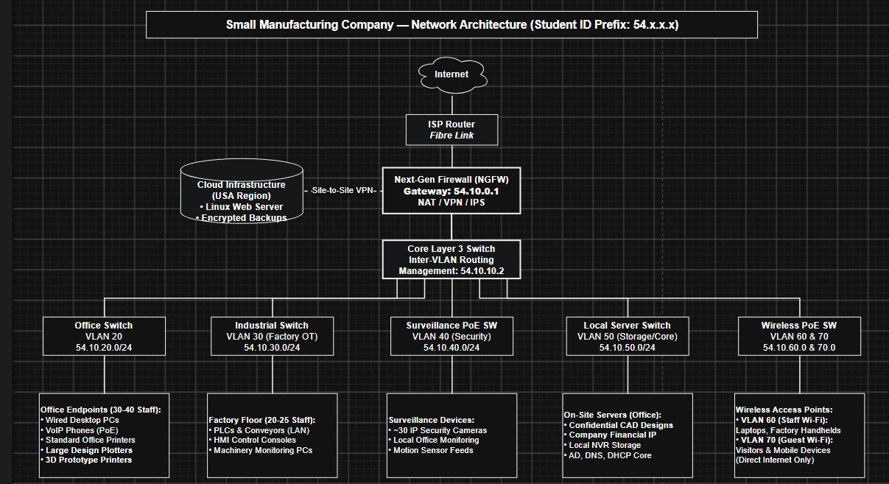

# IS355 Networking and Cyber Security: Group Project

**Authors:** Colin Muller, Collin Morris, Kairi Thomas, Mohammad Abukhdeir

Network design, cloud services analysis, and cybersecurity risk assessment for a small manufacturing company with an attached factory and office building.

## Report Sections

- [Project Plan](Project_Plan.md)
- [Network Design (Draft)](Project_Draft.md)
- [Cloud Services (in progress)](Cloud_Services.md)
- [Security Risk Assessment and Controls (in progress)](Risk_Assessment.md)
- Project Reflection (in progress)

## Network Diagram

Editable source: [network-architecture.drawio](diagrams/network-architecture.drawio)
